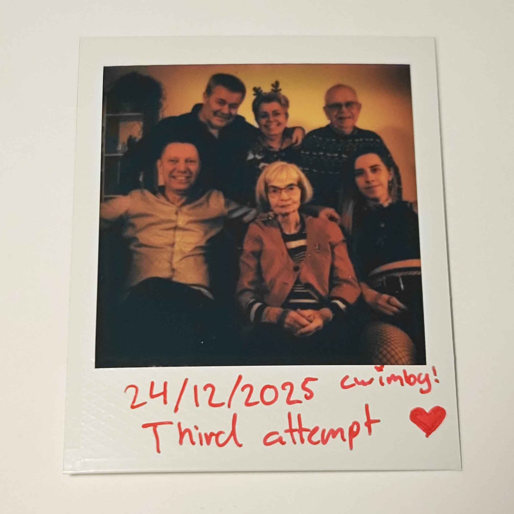

	
<html lang="en">
	<head>
		
	</head>
	<body>
		 
		

			<h1><u>{{ page.date | date: '%b %d, %Y', 'UCT' }}:</u> 06:35 - 23:35</h1>
        

        

			Kæreste Inge, Bedstemor,

            I dag er den 9. november 2026, og det nærmer sig midnat. Da jeg vågnede i morges til et opkald klokken 07:09 kunne jeg godt mærke noget ikke var
            som det burde. Som jeg skriver det her har du været borte i præcis 17 timer. 
            
            Tak for at have været her gennem hele mit liv indtil nu.
            Tak for altid at have været der, og for at acceptere mig for den jeg fandt ud af at jeg var. 
            Du var altid den glade mormor, som havde bagt kage, boller, kranse, ja alt muligt. Du har skabt minder for mig som jeg aldrig vil glemme. Alle turene 
            til Sverige med dig og Bedstefar vil for altid være et kært minde. Der er specielt én aften som står ud i min hukommelse lige nu, og det er måske 
            delvist min (fortsatte) kærlighed for LEGO, men jeg vil aldrig glemme at du sad oppe med mig en sen aften i Sverige, ude i køkkenet, samme dag som 
            vi ankom, fordi jeg synes at min nye LEGO båd skulle samles. Hvis jeg ikke tager meget fejl var det sæt 4669-1, fra 2004, så jeg kan ikke have 
            været meget mere end 6-7 år gammel. 

            Og selvom at André og jeg måske ikke altid var lige tilstedeværende (du ved hvordan unge mennesker kan være), så var det altid hyggeligt at 
            komme hos jer hver onsdag for at overnatte, gennem alle de år. Selvfølgelig altid med en tur i svømmehallen først sammen med Bedstefar, og så 
            hjem til dejlig aftensmad bagefter. 

            I mit hjerte vil du altid være den glade Bedste som altid var klar på at der skulle laves pandekager over bål i sverige, eller som kom med bagte
            goder og god stemning. Tak for gaverne du gav mig, i sjælen og i hånden. For Højskolernes Sangbog, for fotoalbummet og smykkerne. Tæppet som du har 
            vævet har en fast plads på sofaen, og hver gang jeg har gæster er jeg nervøs for at noget kommer det ved. Jeg vil altid mærke din varme gennem 
            det halstørklæde du har givet mig. Og tak for familieportrættet og den gode historie. 

            Du har vist mig, at lige meget hvad livet smider vores vej af svære tider, så kan man altid finde glæden igen, og finde måder at nyde livet på. 

            Du har kæmpet, og nu kan du hvile roligt. Vi skal nok passe på din kære mand. Hvor end du er, håber jeg at du har det godt.

            Jeg elsker dig, og jeg vil for altid sætte pris på det som du har givet mig. 

            I morgen går livet videre, og jeg kan ikke helt tro at det skal være uden dig. Jeg vil altid savne dig.

            Dit ældste barnebarn, 
            Mika

            
		

	</body>
</html>